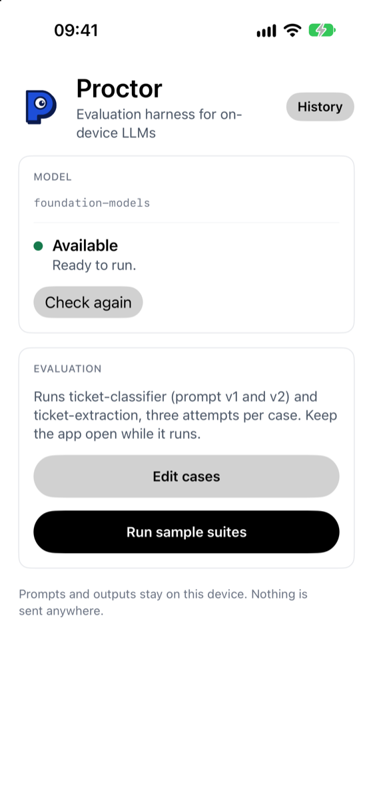
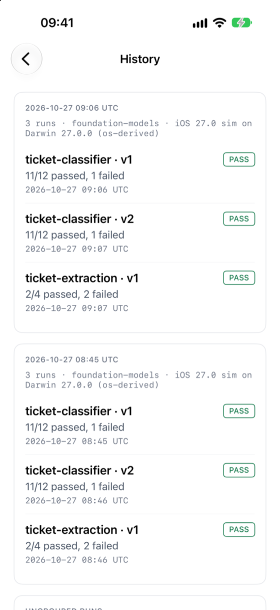
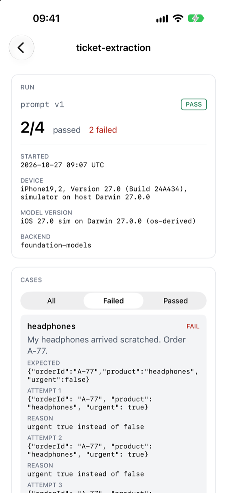

<p align="center"></p>

# Proctor

[](https://github.com/jantursky/proctor/actions/workflows/ci.yml)
[](https://central.sonatype.com/artifact/io.github.jantursky/proctor)
[](https://codecov.io/gh/jantursky/proctor)
[](LICENSE)

Evaluation harness for the language models built into Android and iOS. Write an eval suite once in Kotlin Multiplatform, run it on Gemini Nano and Apple Foundation Models, grade the outputs, and compare platforms, model versions and prompt versions in one report.

Docs in `apps/docs` · [Maven Central](https://central.sonatype.com/artifact/io.github.jantursky/proctor) · [Changelog](CHANGELOG.md) · [Sample report](docs/samples/report/report.md)

> **Status:** not published yet. The iOS backend has run on an iOS 27.0 simulator. The Android backend has run on a Pixel 11 Pro; see the table below.

<p align="center">
<picture><source media="(prefers-color-scheme: dark)" srcset=".github/assets/ios-home-dark.png"></picture> <picture><source media="(prefers-color-scheme: dark)" srcset=".github/assets/ios-history-dark.png"></picture> <picture><source media="(prefers-color-scheme: dark)" srcset=".github/assets/ios-detail-dark.png"></picture>
</p>

<p align="center"><sub>The sample app (`samples/iosApp`) on an iOS 27.0 simulator, using the Mac host's Foundation Models. The Android sample screens look the same and have run against Gemini Nano on a Pixel 11 Pro.</sub></p>

## Why

The OS updates the system model, not your app. A prompt that worked can answer differently after a system update, and different phones run different model versions. Google's ML Kit documentation recommends running an evaluation dataset for each Gemini Nano version, but gives no on-device tool for it. Apple's Evaluations framework covers Apple platforms only.

## Install

```kotlin
commonMain.dependencies { implementation("io.github.jantursky:proctor:1.0.0") }
androidMain.dependencies { implementation("io.github.jantursky:proctor-android:1.0.0") }
iosMain.dependencies { implementation("io.github.jantursky:proctor-ios:1.0.0") }
```

```kotlin
plugins { id("io.github.jantursky.proctor") version "1.0.0" }
```

## Example

```kotlin
val suite = evalSuite("ticket-classifier") {
    prompt(version = "v1") { input -> "Classify this support ticket as Billing, Bug, Account, Feature or Other: $input" }
    case("My card was charged twice", id = "double-charge") { expect("Billing") }
    case("The app crashes when I open the camera", id = "crash") { expect("Bug") }
    graders { exactMatch(ignoreCase = true) }
    repeat(3)
    passWhen { score >= 0.8 }
}

val backend = ForegroundBackend(MlKitBackend(MlKitConfig.PreviewFast), ProctorHostActivity::isForeground)
val results = EvalRunner(backend).runAll(suite)
results.forEach { ResultStore.forApp(context).write(it) }
```

Pull the `*.proctor.json` files from the device (`scripts/pull-results.sh`) and run `./gradlew proctorReport`.

## How it works

1. `proctor/` holds the suite DSL, graders, the runner and the result format. It depends on no model SDK.
2. A backend sends prompts to the system model: `proctor-android/` calls the ML Kit GenAI Prompt API directly, `proctor-ios/` calls Foundation Models through a Swift bridge.
3. The runner sends one request at a time with a pause, backs off on quota errors, and records quota, foreground and availability problems as "not graded", never as prompt failures.
4. Each run writes a JSON file with the device, OS, model version, backend settings and every attempt.
5. `proctor-report/` and the Gradle plugin in `proctor-gradle-plugin/` turn a folder of those files into an HTML and a Markdown report, with diffs between runs and a CI pass condition.

## Platform support

"Checked on" lists only runs that happened. Everything else is unverified.

| Platform | Backend | Checked on | Status |
| --- | --- | --- | --- |
| iOS simulator, iOS 27.0 | Foundation Models | Mac host, macOS 27.0.1 | Run. The simulator uses the host's model. |
| iPhone | Foundation Models | | Unverified |
| Android, stable model | ML Kit Prompt API | Pixel 11 Pro, Android 17, nano-v4-full | Run. Classifier suites 12/12, extraction 3/4. |
| Android, Gemini Nano 4 preview | ML Kit Prompt API | | Unverified. |
| JVM (report, Gradle plugin) | | CI | Run |

Android needs a physical device with a locked bootloader that supports the Prompt API. Emulators have no AICore. AICore serves only the foreground app and enforces a per-app quota. The Galaxy S25 supports only the feature-specific GenAI APIs, not the Prompt API.

On iOS, the Foundation Models framework has no model identifier. Proctor records an OS-derived version and labels it that way.

## Privacy

Proctor sends nothing anywhere: no network code, no telemetry. Prompts, outputs and result files stay on the device until you pull them. An LLM judge or an embedding provider that you pass in may call a cloud service; that is your choice.

## Prior art

- Apple Evaluations framework (WWDC26): Swift-only, Apple platforms, first-party. Better if you ship only on Apple platforms.
- [Dokimos](https://github.com/dokimos-dev/dokimos): evaluators and JUnit integration for Java and Kotlin on the JVM. It does not target on-device system models.
- [promptfoo](https://github.com/promptfoo/promptfoo): declarative evals and red teaming for cloud and local model servers.
- Intents: a macOS workbench for Foundation Models. macOS only.
- `ondevice-ai` and `ondevice-llm`: KMP wrappers for calling the system models. They do not evaluate.

I read the READMEs of Dokimos and promptfoo, not their source.

## Not covered yet

- Tool-call and agent evaluation.
- Synthetic test data generation.
- Image input.
- A command line tool. The report is a library and a Gradle task.
- A desktop JVM backend for prototyping.
- Runs on a physical iPhone and on a physical Android device.

## License

[MIT](LICENSE)
